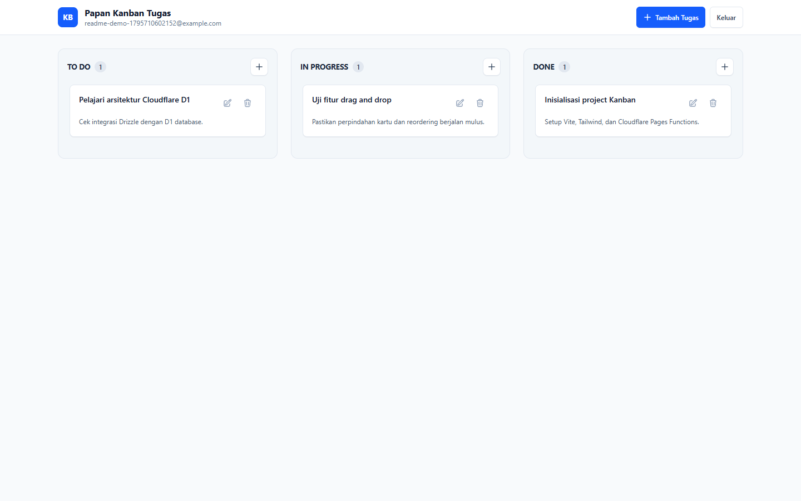
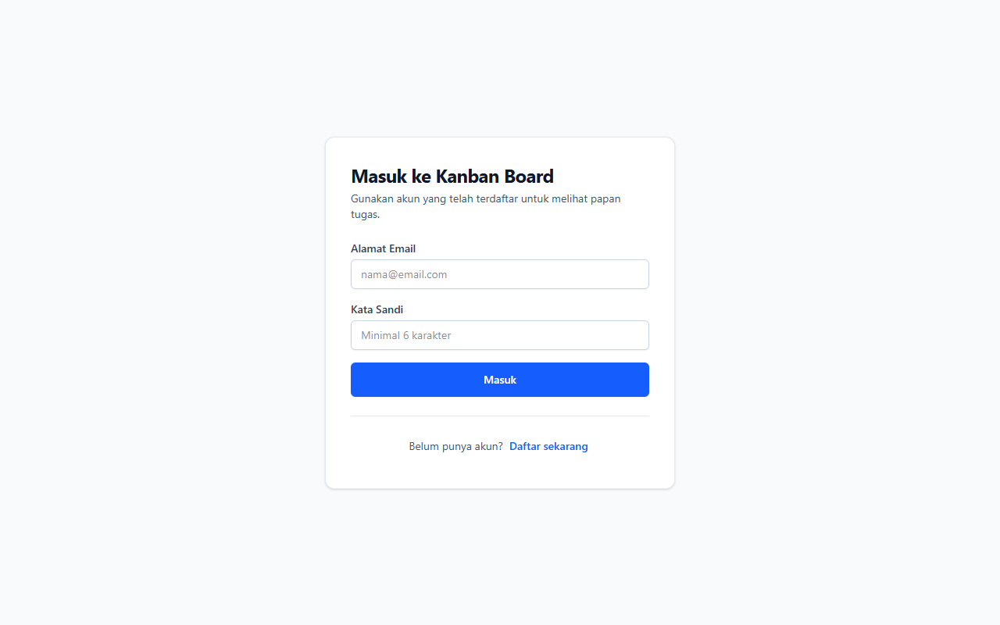

# Kanban Board

Aplikasi manajemen tugas dengan autentikasi, operasi CRUD, dan drag-and-drop. Dibangun sebagai proyek full-stack dengan Cloudflare Pages dan D1.

<p align="center">
  <a href="https://kanban-board-5ka.pages.dev"><strong>Buka aplikasi</strong></a> ·
  <a href="https://github.com/AZWALUWU/kanban-cloudflare/issues">Laporkan masalah</a>
</p>

## Screenshots

### Papan tugas



### Halaman masuk



## Fitur

- Registrasi dan login menggunakan email dan kata sandi.
- Buat, lihat, edit, dan hapus tugas.
- Pindahkan kartu antar kolom dan ubah urutan dengan drag-and-drop.
- Data disimpan per pengguna di Cloudflare D1.
- Layout responsif.

## Tech stack

| Area | Teknologi |
| --- | --- |
| Frontend | React, TypeScript, Vite, Tailwind CSS |
| Drag-and-drop | `@hello-pangea/dnd` |
| API | Hono, Cloudflare Pages Functions |
| Database | Cloudflare D1, Drizzle ORM |
| Password | Web Crypto API, PBKDF2-SHA256 |
| Session | JWT dalam cookie `httpOnly` |
| Hosting | Cloudflare Pages |

## Menjalankan secara lokal

### Prasyarat

- Node.js 20 atau lebih baru
- npm

### Instalasi

```bash
git clone https://github.com/AZWALUWU/kanban-cloudflare.git
cd kanban-cloudflare
npm install
```

Jalankan migrasi D1 lokal, build aplikasi, lalu mulai server Pages:

```bash
npm run db:migrate:local
npm run build
npm run pages:dev
```

Buka [http://localhost:8788](http://localhost:8788), lalu buat akun. Setelah mengubah frontend, jalankan kembali `npm run build` sebelum `npm run pages:dev`.

## Deploy ke Cloudflare

Atur `database_id` dan nama D1 pada binding `DB` di `wrangler.toml` agar cocok dengan database akun Anda.

```bash
npx wrangler login
npx wrangler d1 create kanban-db
# Salin database ID yang dibuat ke wrangler.toml
npm run db:migrate:remote
npm run build
npx wrangler pages deploy ./dist --project-name=kanban-board
```

Tambahkan secret JWT untuk project Pages melalui dashboard Cloudflare, atau jalankan:

```bash
npx wrangler pages secret put JWT_SECRET --project-name=kanban-board
```

Masukkan nilai acak yang kuat saat diminta. Jangan gunakan secret default untuk produksi atau commit secret produksi ke repository.

## Struktur repository

```text
functions/api/[[route]].ts  Hono API
functions/db/schema.ts      Skema Drizzle
functions/lib/crypto.ts     Hash dan verifikasi kata sandi
migrations/                 Migrasi D1
src/                        Aplikasi React
```

## API

Semua endpoint menggunakan prefix `/api`. Endpoint tugas memerlukan sesi aktif.

| Method | Path | Kegunaan |
| --- | --- | --- |
| POST | `/auth/register` | Registrasi |
| POST | `/auth/login` | Login |
| POST | `/auth/logout` | Logout |
| GET | `/auth/me` | Periksa sesi |
| GET | `/tasks` | Daftar tugas |
| POST | `/tasks` | Buat tugas |
| PUT | `/tasks/:id` | Edit tugas |
| DELETE | `/tasks/:id` | Hapus tugas |
| PATCH | `/tasks/reorder` | Simpan posisi dan kolom kartu |

## Keamanan

- Simpan `JWT_SECRET` sebagai Cloudflare secret dengan nilai acak yang kuat.
- Cookie sesi menggunakan `httpOnly` dan `SameSite=Lax`. Deployment produksi harus menggunakan HTTPS dan cookie `Secure`.
- Jangan gunakan data akun pribadi pada screenshot yang dipublikasikan.

## Lisensi

Lisensi belum ditetapkan. Minta izin pemilik repository sebelum menggunakan atau mendistribusikan ulang kode.
